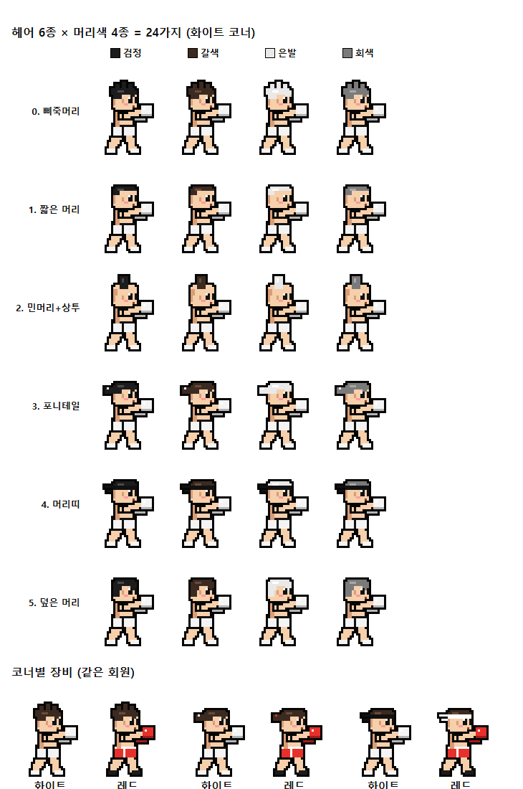

# 🥊 TBG ARENA

TBG 체육관 회원 전용 **복싱 육성 시뮬레이션** 모바일 웹 게임.
체육관에서 **실제로 배운 기술**이 내 선수의 기술이 되고, **체육관에 실제로 나올수록** 강해집니다. 앱 안에서 버튼으로 키우는 요소는 없고, 회원끼리 **콜아웃**해서 겨룹니다.

## 실행

```bash
npm start                 # http://localhost:3000
COACH_PIN=9876 npm start  # 코치 PIN 지정 (기본값 1234 → 운영 시 꼭 변경)
```

### 테스트용 샘플 데이터

```bash
npm start          # 서버 켠 상태에서
npm run seed       # 다른 터미널에서 실행
```

- 회원 8명 (`010-0000-0001` ~ `010-0000-0008`) + 각자 배운 기술 + 출석 + 경기 8판
- `010-0000-0001` 김도윤: 받은 콜아웃(수락 대기) 있음
- 코치 화면: 승인 대기 콜아웃 1건
- `010-0000-0006` 한소율: 오늘 미출석 (출석 체크 테스트용)
- 여러 번 실행해도 중복 생성되지 않음

- 외부 패키지 없음 (Node.js 18+)
- 로컬에서는 데이터가 `data/db.json` 에 저장 (gitignore)
- 같은 Wi‑Fi 휴대폰에서 `http://<PC IP>:3000` 접속 → 홈 화면에 추가하면 앱처럼 실행

## Vercel 배포

`server.js` 하나로 로컬 서버와 Vercel 서버리스(`api/index.js`)를 같이 씁니다. 저장소는 `store.js` 가 자동 선택:
Redis 환경변수가 있으면 **Upstash Redis**, 없으면 로컬 파일.

1. Vercel에서 이 GitHub 레포를 Import (Framework: Other, 빌드 설정은 비워 두면 `public/` 이 정적 파일로, `api/` 가 함수로 배포됨)
2. 프로젝트 → **Storage** → **Upstash for Redis** 생성 후 연결 → `KV_REST_API_URL`, `KV_REST_API_TOKEN` 자동 등록
3. **Settings → Environment Variables** 에 `COACH_PIN` 추가 (기본값 1234 그대로 두지 말 것)
4. Redeploy

- 정적 파일은 `public/`, `/api/*` 는 서버리스 함수 하나가 처리
- 요청마다 Redis에서 DB를 불러와 처리 후 저장. 경기 중계 데이터는 경기별 키(`tbg:fight:<id>`)로 분리
- 배포본에 샘플 데이터 넣기: `BASE_URL=https://<배포주소> COACH_PIN=<PIN> npm run seed`
- 동시에 여러 서버 인스턴스가 쓰면 마지막 저장이 이기는 구조라, 체육관 규모(동시 사용 적음)를 전제로 함

## 게임 루프

```
코치: 회원 등록 → 배운 기술 등록(분류·숙련도) → 출석 체크
회원: 전화번호로 입장 → 전략 설정
      → 콜아웃 → [코치 승인] → [상대 수락] → 자동 경기 → 중계 관전
```

### 선수
- 능력치: ⚡파워 💨스피드 🫁스태미나 🧠IQ 🛡맷집 → **전투력**
- 능력치는 **코치 출석 체크 때만** 성장 (하루 1회, 5개 능력치 모두 조금씩, 높을수록 둔화)

### 기술 (코치 = admin 이 등록)
- **현재는 복싱 기술만** 지원. 분류: 👊 잽·스트레이트 / 🪝 훅 / ⤴️ 어퍼컷 / 🎯 바디샷 / 🛡️ 디펜스
  - 잽·스트레이트: 정확도 ↑ 데미지 ↓ · 훅/어퍼컷: 데미지·KO 확률 ↑ · 바디샷: 상대 체력(스태미나) 소모
  - 디펜스(슬립·위빙·더킹·패리·블로킹 등): 공격으로는 안 나오고, 숙련이 높을수록 덜 맞고 카운터 확률 ↑
- 서버 시작 시 예전 MMA 기술은 정리됨: 펀치는 이름으로 세부 분류(훅/어퍼/바디/그 외 잽·스트레이트), 킥·태클·그라운드·서브미션은 삭제
- **배운 기술만 경기에 나오고, 숙련이 높을수록 자주 나오고 잘 들어간다**
- 숙련은 코치가 수업에서 본 실력대로 직접 조정(±5)하고, 경기에서 성공한 기술은 +1
- 같은 기술로 5번 피니시하면 `○○ 마스터` 칭호

### 전략
- 스탠스(오소독스/사우스포), 가드(하이가드/숄더롤/밸런스), 스타일(인파이팅/카운터/아웃복싱), 공략 부위(헤드·바디)

### 경기 엔진 (`fight.js`)
- 3라운드 × 3분 복싱
- 공격권은 스피드·스타일·체력, 성공률은 숙련·스피드·IQ·상대 가드·상대 디펜스 숙련
- 피니시: KO / TKO (다운 후 카운트 아웃 포함), 아니면 심판 3명 10-9 채점 판정
- 결과: Elo 방식 랭킹 포인트(피니시 보너스), 팬, 전적, 피니시 칭호

### 경기 애니메이션 (`public/arena.js`)
- 사이드뷰 도트 아트: 160×100 월드 버퍼를 nearest-neighbor로 확대, 회원 ID별로 헤어가 다른 2등신 캐릭터 (화이트 코너 / 레드 코너)
- 복싱 기술별 모션: 잽(앞손 스냅) · 스트레이트(뒷손+체중) · 원투/더블 잽(연속 펀치) · 훅(와인드업→팔 굽혀 휘두르기, 곡선 궤적) · 어퍼컷(숙였다 올려치기, 수직 궤적) · 바디샷(낮게 숙여 치기)
- 맞는 반응도 기술별: 고개가 옆으로(훅) / 위로(어퍼컷) / 몸이 접힘(바디). 디펜스는 기술 이름으로 슬립·위빙/더킹·블로킹·패리·백스텝 동작
- 히트스톱, 피격 화이트 플래시, 임팩트 버스트, 땀 파티클, 넉백, 카메라 펀치 줌, 관중 점프·카메라 플래시
- KO: 반전 플래시 → 슬로모션으로 날아가 바운드 → 스피드 라인 → 레터박스 + K.O. 배너 → 승자 세리머니
- 테이크다운 슬램·먼지, 마운트 파운딩, 서브미션 비네트·TAP, 라운드 인트로(ROUND N → FIGHT!)
- 효과음 (`public/sfx.js`): Web Audio로 8비트 소리를 실시간 합성(음원 파일 없음). 중계 화면 우상단 ♪ 버튼으로 켜고 끔(설정 기억), 3x·8x 배속에선 자잘한 소리 생략
- `PixelFighter.url(id, {pose})` 로 같은 캐릭터를 아바타·프로필에도 사용, 로그인 화면은 데모 스파링

### 캐릭터 스킨
회원 ID 해시로 **헤어 6종 × 머리색 4종 = 24가지** 중 하나가 자동으로 정해집니다 (같은 회원은 어디서나 같은 모습). 장비 색은 코너로 정해집니다: 화이트 코너(흰 글러브·트렁크) / 레드 코너(빨간 글러브·트렁크, 검정 신발).



## 구조

```
server.js   # HTTP 서버 + REST API (의존성 0)
fight.js    # 경기 시뮬레이션 엔진
public/     # Vanilla JS SPA (회원 / 코치 / 중계), 모바일 우선 블랙&화이트 + 도트
```
